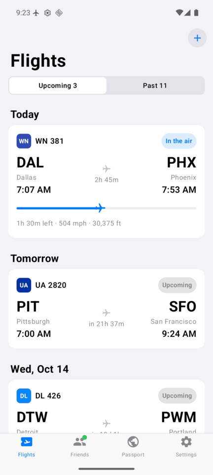
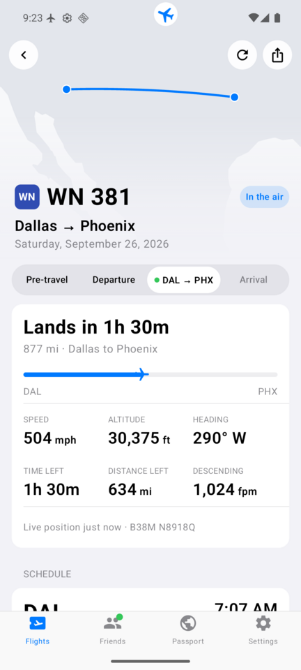
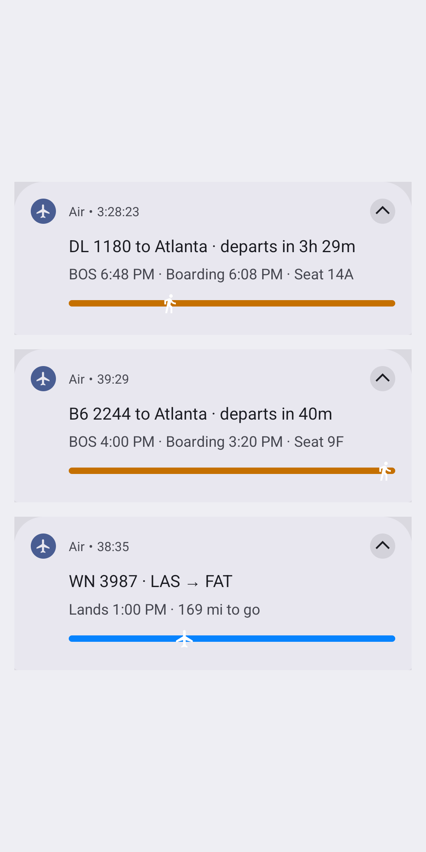
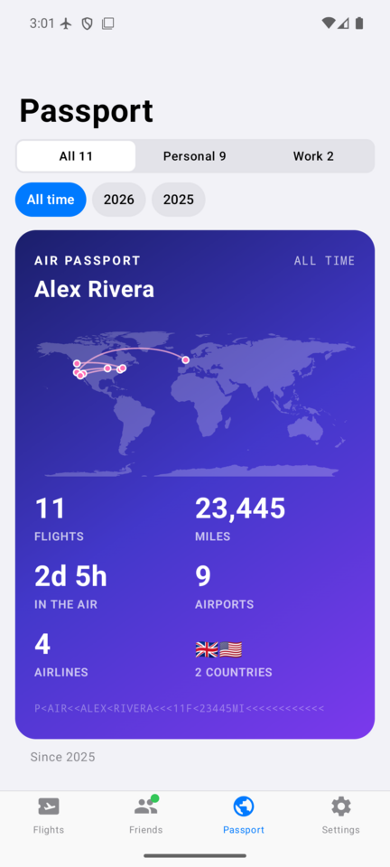

# Air

A private flight tracker and travel passport for Android. Track your own flights and friends' live, see your travel
history on a map, and import confirmations by just sharing them to the app. Everything stays on the phone.
This entire app is vibe coded and was built for a single user, me, so use it at your own risk and verify the code
yourself.

<!-- screenshots:start -->

   

<!-- screenshots:end -->

## Features

- Live tracking for your own flights and friends', with gate, delay, and takeoff/landing notifications.
- A live notification that follows each flight: a countdown with the time to leave, boarding and the gate at the
  airport, then progress, speed and landing time in the air. Each of yours gets its own card; friends' share one
  ("2 of 3") with a Next flight button. Switch them on or off separately in Settings › Notifications.
- A flight page with a route map, schedule, weather at both ends, your plane's previous flight, and (while airborne)
  speed, altitude and heading. Connecting flights show as one journey.
- Map layers: radar, forecast radar for US takeoffs, weather along the route, and the paths earlier flights took.
- Import by sharing a confirmation email, PDF, or screenshot to the app, or by printing an email to "Save to Air".
  OCR and PDF text extraction run on-device.
- Optional Gmail scan: link one or more mailboxes with an app password and Air finds past and new bookings for you
  to pick from. Manual, or every few weeks in the background.
- Terminal maps from OpenStreetMap: floors, gates, food, restrooms and shops, opened on your gate. The 30 busiest US
  airports ship with the app; others download once and then work offline. Tap the Map chip on a flight, or the
  Terminal map button on the live notification. A you-are-here dot (location is read on the phone only, while the map
  is open).
- An aircraft page for the plane flying your flight: model, age, seats, and how late its last week of flights landed.
- A passport view: every past flight on a map, with miles, time in the air, top airports/airlines/routes/aircraft,
  and a year in review (estimated CO₂, on-time rate, busiest month, new airports, the year before).
- A home screen widget with the route map, radar and a countdown. It takes turns between your upcoming flights and
  friends', and stays on yours once you're under way (› peeks at the others). Stretched to about four rows it shows
  two: yours on top, friends' taking turns below.
- Pick a color for your flights and one for friends' (Settings › About): routes, cards, the widget and the passport.

## Install

Download the latest APK from [Releases](https://github.com/goldbattle/air/releases) and sideload it. Air checks
GitHub for new releases itself (Settings > About > Check for updates, with an optional daily background check) and
installs them in place. To publish releases from a fork, see [.github/RELEASING.md](.github/RELEASING.md).

## Data sources

There's no account and no analytics. Your flights, emails and backups stay on the phone; these services only see
what's listed. Layers marked *off by default* make no requests until you turn them on.

| Source | Used for | What it's sent | How often |
|---|---|---|---|
| [adsb.lol](https://adsb.lol) | Live positions, routes, the plane's previous flight, the path a flight actually flew | Callsign, tail number or aircraft hex | Every 1–10 min around and during a flight; a flight's full path once after landing |
| [Open-Meteo](https://open-meteo.com) | Weather at takeoff and landing; weather along the route (*off by default*) | Airport or route coordinates and times | Daily when far out, every 6 h in the last 3 days, every 3 h on the day |
| [RainViewer](https://www.rainviewer.com/api.html) | Radar on the map and widget | Map tile coordinates | Every 10 min while shown, from 6 h before departure until the flight's rain map is out |
| [NASA GIBS (IMERG)](https://gibs.earthdata.nasa.gov) | Rain during past flights, worldwide | A time | Once per 3-hour slot, about 7 h after the flight; kept on the phone and in exports |
| [NOAA HRRR via Iowa State](https://mesonet.agron.iastate.edu) | Forecast radar for US takeoffs (*off by default*) | Nothing but the forecast step | Hourly while shown, up to 48 h before takeoff |
| [AeroDataBox](https://aerodatabox.com) (your key) | Status, delays, gates, aircraft; past routes (*off by default*); the aircraft page | Flight number and date; the tail number on the aircraft page | Weekly far out down to every 20 min near departure; past routes one day per request, at most once a day; the aircraft page when opened, at most every 6 h |
| [FlightAware AeroAPI](https://www.flightaware.com/commercial/aeroapi/) (your key) | Gates, tail number and inbound plane when AeroDataBox lacks them; past routes fallback; the aircraft page's flights without an AeroDataBox key | Flight number; tail number | Only when something's missing in the last 12 h, on a gate change, or on pull to refresh |
| [OpenStreetMap via Overpass](https://wiki.openstreetmap.org/wiki/Overpass_API) | Terminal maps (© OpenStreetMap contributors, ODbL; the bundled ones are made with `tools/airport_maps.py`) | The airport's code or coordinates | Once per airport not bundled, ahead of an upcoming flight or when opened; any map again after a month |
| GitHub | Update check | Nothing | Daily (can be turned off) |
| Your mail server | Gmail scan (optional) | Your address and app password, encrypted on the phone | Manual, or every 1–4 weeks |

Backups are a JSON file you export yourself.

---

Copyright (C) 2026 Patrick Geneva. Licensed under the [GPL-3.0](LICENSE).
